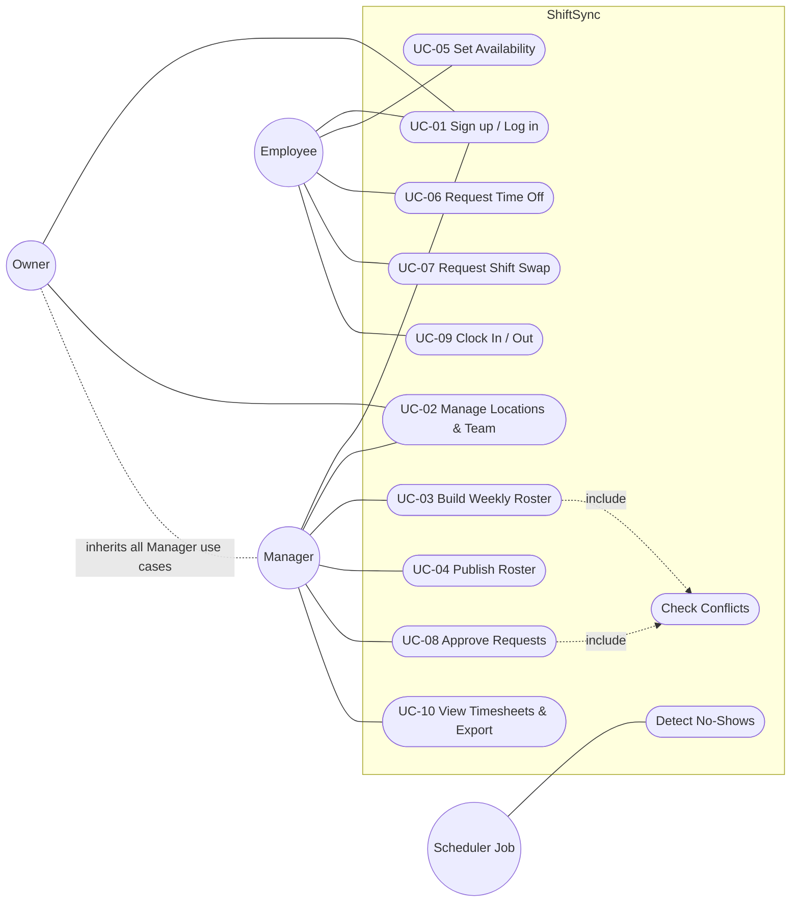

# ShiftSync — Week 2 Progress Report

**Software Requirements Specification (SRS) — IEEE 830 Format**

| Field | Detail |
|---|---|
| Project ID | PTUT-PRJ-039 |
| Project Title | ShiftSync – Automated Employee Shift Scheduling & Attendance App |
| Track | 4. Local Commerce, SMB & Retail Operations |
| Student | Saniya |
| Roll Number | 24-ST-045 |
| Email | 24-st-045@students.ptut.edu.pk |
| Supervisor | Dr. Zaigham Mushtaq |
| Reporting Week | Week 2 of 12 |
| Document Version | 1.0 |

---

## Week 2 Summary of Work Completed

- Authored the Software Requirements Specification below following the IEEE 830-1998 structure.
- Identified 3 actors (Owner, Manager, Employee) plus 1 system actor (Scheduler Job) and wrote 10 formal use-case specifications.
- Produced the System Use Case Diagram (Section 3.3).
- Defined 52 uniquely numbered functional requirements traceable to the 5 MVP features from Week 1.
- Specified 20 quantifiable non-functional requirements covering latency, security, availability, scalability and usability.

---

## 1. Introduction

### 1.1 Purpose
This SRS describes the functional and non-functional requirements of **ShiftSync**, a web application for automated employee shift scheduling and attendance tracking in small retail and food businesses. It is intended for the project supervisor, the developer, and evaluators of the Final Year Project, and serves as the baseline for design (Weeks 3–4), implementation (Weeks 5–9) and testing (Week 10).

### 1.2 Scope
ShiftSync replaces paper rosters and WhatsApp-based shift coordination with a single system that:
- lets managers build, check and publish weekly rosters;
- lets employees declare availability, request time off and swap shifts through an approval workflow;
- records clock-in/clock-out attendance and produces timesheets.

Out of scope for this version: payroll processing and payments, POS integration, native mobile apps (the web app is mobile-responsive), and multi-language UI.

### 1.3 Definitions, Acronyms and Abbreviations

| Term | Definition |
|---|---|
| Organisation (Tenant) | A business account; all data is isolated per organisation. |
| Location | A physical store/branch belonging to an organisation. |
| Shift | A scheduled block of work for one employee (or open) at one location. |
| Roster | The set of shifts for a location for one week (Monday–Sunday). |
| Publish | Making a draft roster visible to employees. |
| Swap | Transfer of a shift from one employee to another, subject to approval. |
| Geofence | A circular area (centre + radius) around a location used to validate clock-ins. |
| RBAC | Role-Based Access Control. |
| JWT | JSON Web Token used for session authentication. |
| p95 | 95th percentile of measured response times. |

### 1.4 References
1. IEEE Std 830-1998, *IEEE Recommended Practice for Software Requirements Specifications*.
2. OWASP Top 10 (2021).
3. ShiftSync Week 1 Report — Problem Discovery & User Personas.

### 1.5 Overview
Section 2 describes the product in general terms. Section 3 lists specific requirements: external interfaces, functional requirements, use cases, and non-functional requirements.

---

## 2. Overall Description

### 2.1 Product Perspective
ShiftSync is a new, self-contained, multi-tenant web system built as three tiers: a React single-page client, a Node.js/Express REST API, and a PostgreSQL database. It runs in any modern browser on desktop or phone and does not depend on any existing system at the client business.

### 2.2 Product Functions (Summary)
1. Account and organisation management (sign-up, login, invite employees, locations).
2. Weekly roster builder with automatic conflict detection and publishing.
3. Availability and time-off management.
4. Shift swap and open-shift cover marketplace with manager approval.
5. Clock-in/clock-out attendance with lateness and no-show detection.
6. Timesheets, CSV export and in-app notifications.

### 2.3 User Classes and Characteristics

| User Class | Description | Frequency of Use | Technical Skill |
|---|---|---|---|
| Owner | Creates the organisation; manages locations and managers; full access. | Weekly | Low–medium |
| Manager | Builds rosters, approves requests, monitors attendance and timesheets for assigned locations. | Daily | Low–medium |
| Employee | Views schedule, sets availability, requests swaps/time off, clocks in/out. | Daily (on shift days) | Low; mostly smartphone |

### 2.4 Operating Environment
- Client: latest two versions of Chrome, Edge, Firefox and Safari (desktop and mobile); minimum screen width 360 px.
- Server: Node.js 20+ on Linux (Render) or Windows (development).
- Database: PostgreSQL 15+ (Neon/Supabase in production).

### 2.5 Design and Implementation Constraints
- Must be deployable on zero-cost cloud tiers (Vercel, Render, Neon/Supabase).
- All times stored in UTC; displayed in the location's time zone.
- Passwords must be hashed with bcrypt; no plaintext secrets in the repository.
- TypeScript is used on both client and server.

### 2.6 Assumptions and Dependencies
- Employees have a smartphone with a browser and internet access while at work.
- Browser geolocation is available but may be denied or inaccurate; PIN fallback is provided.
- One employee works at most one shift at a time.

---

## 3. Specific Requirements

### 3.1 External Interface Requirements

**3.1.1 User Interfaces** — responsive web UI with: Landing, Sign-up, Login, Dashboard (role-aware), Roster Builder, My Schedule, Availability, Time Off, Requests Inbox, Attendance board, Timesheets, Team management, Notifications panel. Feedback is given through toast messages; destructive actions require confirmation.

**3.1.2 Software Interfaces** — REST/JSON API over HTTPS under `/api`; PostgreSQL via Prisma ORM; browser Geolocation API; (Week 8) Google Gemini API for schedule suggestions and an email/messaging provider for notifications.

**3.1.3 Communication Interfaces** — HTTPS (TLS 1.2+) only in production; authentication via httpOnly, Secure, SameSite cookie containing a JWT.

### 3.2 Functional Requirements

**FR-A: Authentication & Organisation**

| ID | Requirement | Priority |
|---|---|---|
| FR-A1 | The system shall allow a new user to sign up by providing organisation name, full name, email and password, creating an organisation with the user as Owner. | High |
| FR-A2 | The system shall reject passwords shorter than 12 characters or longer than 72 bytes (bcrypt limit). | High |
| FR-A3 | The system shall authenticate users by email and password and issue a session token valid for 7 days. | High |
| FR-A4 | The system shall allow users to log out, invalidating the session cookie. | High |
| FR-A5 | The system shall allow Owners/Managers to invite employees, generating a one-time temporary password. | High |
| FR-A6 | The system shall allow Owners to create, edit and delete locations with time zone, coordinates, geofence radius and grace period. | High |
| FR-A7 | The system shall restrict every data access to the user's own organisation. | High |
| FR-A8 | The system shall enforce role permissions (Owner > Manager > Employee) on every API endpoint. | High |
| FR-A9 | The system shall allow Managers to set an employee's hourly rate, maximum weekly hours and position. | Medium |
| FR-A10 | The system shall rate-limit authentication requests (sign-up/login) to 60 per 15 minutes per IP address. | High |

**FR-R: Roster Builder**

| ID | Requirement | Priority |
|---|---|---|
| FR-R1 | The system shall display a weekly grid of employees × days for a selected location and week. | High |
| FR-R2 | The system shall allow Managers to create, edit and delete shifts (employee or open, start, end, position, notes). | High |
| FR-R3 | The system shall detect overlapping shifts for the same employee and block saving unless the Manager explicitly overrides. | High |
| FR-R4 | The system shall warn when a shift falls outside the employee's declared availability. | High |
| FR-R5 | The system shall warn when a shift clashes with approved time off. | High |
| FR-R6 | The system shall warn when an employee's weekly hours would exceed their maximum. | High |
| FR-R7 | The system shall warn when an employee has less than 10 hours rest between consecutive shifts. | Medium |
| FR-R8 | The system shall copy all shifts from the previous week into the current week as drafts. | Medium |
| FR-R9 | The system shall publish all draft shifts of a week, making them visible to employees. | High |
| FR-R10 | The system shall show each employee's weekly scheduled hours and estimated labour cost. | Medium |
| FR-R11 | The system shall support overnight shifts that end on the following day. | Medium |

**FR-V: Availability & Time-Off**

| ID | Requirement | Priority |
|---|---|---|
| FR-V1 | The system shall allow an employee to set recurring availability windows per weekday. | High |
| FR-V2 | The system shall allow an employee to submit a time-off request with date range and reason. | High |
| FR-V3 | The system shall allow an employee to cancel a pending time-off request. | Medium |
| FR-V4 | The system shall allow Managers to approve or deny time-off requests. | High |
| FR-V5 | The system shall notify the employee when a time-off request is decided. | Medium |

**FR-S: Shift Swap & Cover**

| ID | Requirement | Priority |
|---|---|---|
| FR-S1 | The system shall allow an employee to offer one of their published future shifts to a specific coworker or as an open shift. | High |
| FR-S2 | The system shall list open shifts to eligible coworkers at the same location. | High |
| FR-S3 | The system shall allow an eligible coworker to accept an offered shift. | High |
| FR-S4 | The system shall allow Managers to approve or reject accepted swaps. | High |
| FR-S5 | The system shall re-run conflict checks for the new assignee before approval. | High |
| FR-S6 | The system shall reassign the shift atomically when a swap is approved. | High |
| FR-S7 | The system shall prevent more than one active swap request per shift. | High |
| FR-S8 | The system shall allow the requester to cancel a swap while it is pending or accepted. | Medium |
| FR-S9 | The system shall notify the requester, the acceptor and the Manager at each state change. | Medium |

**FR-T: Attendance**

| ID | Requirement | Priority |
|---|---|---|
| FR-T1 | The system shall allow an employee to clock in to their shift from 15 minutes before its start. | High |
| FR-T2 | The system shall verify the employee's PIN when one is configured. | Medium |
| FR-T3 | The system shall reject a clock-in outside the location geofence when coordinates are provided and a geofence is configured. | Medium |
| FR-T4 | The system shall allow the employee to clock out of an open attendance record. | High |
| FR-T5 | The system shall mark attendance as LATE when clock-in is later than start + grace minutes. | High |
| FR-T6 | The system shall mark attendance as EARLY_LEAVE when clock-out is before shift end. | Medium |
| FR-T7 | The system shall automatically mark NO_SHOW for shifts ended over 30 minutes without a clock-in. | High |
| FR-T8 | The system shall show Managers a live board of today's shifts with status (in / late / not arrived / completed). | High |
| FR-T9 | The system shall allow Managers to correct attendance records with a mandatory note recorded in an audit log. | Medium |

**FR-N: Timesheets & Notifications**

| ID | Requirement | Priority |
|---|---|---|
| FR-N1 | The system shall compute per-employee scheduled hours, actual hours, overtime and late count for a date range. | High |
| FR-N2 | The system shall export timesheets as a CSV file. | High |
| FR-N3 | The system shall estimate labour cost from actual hours × hourly rate. | Medium |
| FR-N4 | The system shall create in-app notifications for roster publish, swap and time-off decisions and no-shows. | High |
| FR-N5 | The system shall show an unread notification count and allow marking one or all notifications as read. | Medium |
| FR-N6 | The system shall restrict timesheets to Owners and Managers; employees may view only their own hours. | High |
| FR-N7 | (Week 8) The system shall suggest a draft roster using Google Gemini based on availability and staffing needs. | Low |
| FR-N8 | (Week 8) The system shall send email or messaging notifications for published rosters and decisions. | Low |

### 3.3 System Use Case Diagram

*Owner is a specialisation of Manager and can perform every Manager use case.*

### 3.4 Use Case Specifications

#### UC-01 Sign Up / Log In
| Item | Description |
|---|---|
| Actors | Owner (sign-up), all users (log in) |
| Preconditions | User has a browser and internet access. |
| Main Flow | 1. User opens Sign-up and enters organisation name, name, email, password. 2. System validates input and checks the email is unused. 3. System creates the organisation and Owner account, hashes the password with bcrypt and sets a session cookie. 4. System opens the Dashboard. |
| Alternative Flow | 1a. Login: user enters email and password; system verifies hash and issues session. |
| Exceptions | E1 Email already registered → error shown. E2 Wrong credentials → generic "invalid email or password". E3 More than 60 authentication requests in 15 minutes → HTTP 429. |
| Postconditions | User is authenticated with a role-scoped session. |
| Requirements | FR-A1–A4, FR-A10 |

#### UC-02 Manage Locations & Team
| Item | Description |
|---|---|
| Actors | Owner, Manager |
| Preconditions | Actor logged in. |
| Main Flow | 1. Actor opens Team. 2. Enters employee name, email, role, hourly rate, max weekly hours. 3. System creates the account and shows a one-time temporary password. 4. Owner may add a location with time zone, coordinates and geofence. |
| Exceptions | E1 Email already exists in organisation. E2 Manager attempts to create an Owner → 403. |
| Postconditions | Employee can log in and is assigned to the location. |
| Requirements | FR-A5, A6, A8, A9 |

#### UC-03 Build Weekly Roster
| Item | Description |
|---|---|
| Actors | Manager |
| Preconditions | Location and employees exist. |
| Main Flow | 1. Manager opens Roster Builder and selects a location and week. 2. Clicks a cell and enters start, end and position. 3. System checks conflicts (include: *Check Conflicts*). 4. System saves the shift as DRAFT and updates hours/cost totals. |
| Alternative Flow | 2a. Manager clicks "Copy last week"; system copies shifts as drafts. |
| Exceptions | E1 Overlap → save blocked with warning; Manager may tick override. E2 Soft conflicts (availability, time-off, max hours, rest) → saved with warning badges. |
| Postconditions | Draft shifts stored for the week. |
| Requirements | FR-R1–R8, R10, R11 |

#### UC-04 Publish Roster
| Item | Description |
|---|---|
| Actors | Manager |
| Preconditions | Week contains at least one draft shift. |
| Main Flow | 1. Manager clicks "Publish week". 2. System re-checks conflicts. 3. System sets all drafts to PUBLISHED. 4. System notifies affected employees. |
| Exceptions | E1 Unresolved overlaps → system asks for explicit confirmation. |
| Postconditions | Employees can see their shifts. |
| Requirements | FR-R9, FR-N4 |

#### UC-05 Set Availability
| Item | Description |
|---|---|
| Actors | Employee |
| Main Flow | 1. Employee opens Availability. 2. Adds time windows per weekday. 3. System validates start < end and saves. |
| Exceptions | E1 Overlapping windows on the same day → validation error. |
| Postconditions | Roster Builder uses the windows for conflict checks. |
| Requirements | FR-V1, FR-R4 |

#### UC-06 Request Time Off
| Item | Description |
|---|---|
| Actors | Employee (request), Manager (decision) |
| Main Flow | 1. Employee submits date range and reason. 2. Request saved as PENDING. 3. Manager approves or denies in Requests Inbox. 4. Employee is notified. |
| Alternative Flow | 1a. Employee cancels a pending request. |
| Postconditions | Approved time off produces conflict warnings in Roster Builder. |
| Requirements | FR-V2–V5, FR-R5 |

#### UC-07 Request Shift Swap
| Item | Description |
|---|---|
| Actors | Employee (requester), Employee (acceptor) |
| Preconditions | Requester owns a published future shift with no active swap. |
| Main Flow | 1. Requester selects a shift and chooses a coworker or "open shift". 2. System creates swap request (PENDING) and notifies target/eligible coworkers. 3. Coworker accepts → ACCEPTED. 4. Manager is notified for approval (UC-08). |
| Alternative Flow | 3a. Requester cancels → CANCELLED. |
| Exceptions | E1 Shift already has an active swap → 409. E2 Acceptor not at the same location → 403. |
| Requirements | FR-S1–S3, S7–S9 |

#### UC-08 Approve Requests
| Item | Description |
|---|---|
| Actors | Manager |
| Main Flow | 1. Manager opens Requests Inbox. 2. Selects an accepted swap. 3. System re-checks conflicts for the acceptor (include: *Check Conflicts*). 4. Manager approves; system reassigns the shift in one transaction and notifies all parties. |
| Alternative Flow | 4a. Manager rejects → REJECTED; requester keeps the shift. |
| Exceptions | E1 Overlap for acceptor → 409 unless Manager overrides. |
| Requirements | FR-S4–S6, FR-V4 |

#### UC-09 Clock In / Out
| Item | Description |
|---|---|
| Actors | Employee |
| Preconditions | Employee has a shift starting within 15 minutes or in progress. |
| Main Flow | 1. Employee taps "Clock in". 2. Browser supplies coordinates (if allowed); employee enters PIN if required. 3. System validates time window, PIN and geofence. 4. System records clock-in and computes ON_TIME or LATE. 5. Later, employee taps "Clock out"; system records time and computes EARLY_LEAVE if applicable. |
| Exceptions | E1 Outside geofence → rejected with distance shown. E2 Wrong PIN → rejected. E3 Too early → rejected. |
| Postconditions | Attendance record stored; Manager board updated. |
| Requirements | FR-T1–T6, T8 |

#### UC-10 View Timesheets & Export
| Item | Description |
|---|---|
| Actors | Manager, Owner |
| Main Flow | 1. Manager selects date range and location. 2. System computes scheduled vs actual hours, overtime, late count and cost per employee. 3. Manager downloads CSV. |
| Exceptions | E1 Employee tries to access → 403. |
| Requirements | FR-N1–N3, N6 |

### 3.5 Non-Functional Requirements

| ID | Category | Requirement | Measurement |
|---|---|---|---|
| NFR-P1 | Performance | API read endpoints shall respond within **300 ms at p95**; write endpoints within **500 ms at p95**. | Load test with 50 concurrent users (k6/autocannon). |
| NFR-P2 | Performance | Conflict checking for a week roster of 50 employees / 350 shifts shall complete in **< 200 ms**. | Unit benchmark on domain function. |
| NFR-P3 | Performance | Initial page load (LCP) shall be **< 2.5 s** on a 4G mobile connection. | Lighthouse mobile audit. |
| NFR-P4 | Performance | Client JavaScript bundle shall be **< 350 KB gzipped**. | Vite build report. |
| NFR-S1 | Security | Passwords shall be hashed with **bcrypt, cost factor 12**; plaintext passwords are never logged or stored. | Code review + unit test. |
| NFR-S2 | Security | Session tokens shall be stored in **httpOnly, Secure, SameSite=Lax** cookies and expire after **7 days**. | Response header inspection. |
| NFR-S3 | Security | **100%** of API endpoints except health, sign-up and login shall require authentication. | Automated route test. |
| NFR-S4 | Security | No cross-tenant data access: automated isolation tests shall show **0** leaks across all resource endpoints. | Integration test suite. |
| NFR-S5 | Security | All input shall be validated server-side (Zod); the app shall pass an OWASP Top 10 review with **0 high/critical** findings. | Week 10 audit + `npm audit`. |
| NFR-S6 | Security | Authentication requests shall be limited to **60 / 15 min / IP**; further attempts receive HTTP 429. | Integration test. |
| NFR-S7 | Security | All production traffic shall use **HTTPS (TLS 1.2+)** with security headers (Helmet). | SSL Labs grade A or better. |
| NFR-A1 | Availability | The production API shall target **99.5% monthly uptime** (≈ 3.6 h downtime/month). | Uptime monitor on `/api/health`. |
| NFR-A2 | Reliability | Database shall be backed up **daily** with **7-day** retention (provider-managed). | Provider settings. |
| NFR-A3 | Reliability | Swap approval and roster publish shall be **atomic** (all-or-nothing transactions). | Integration tests. |
| NFR-SC1 | Scalability | The system shall support **100 organisations × 50 employees** without schema change. | Seeded load test. |
| NFR-U1 | Usability | A new manager shall create and publish a 7-day roster for 8 employees in **under 15 minutes**. | Timed usability test (3 users). |
| NFR-U2 | Usability | An employee shall clock in within **3 taps** from opening the app. | UI walkthrough. |
| NFR-U3 | Usability | UI shall be fully usable at **360 px** width and meet **WCAG 2.1 AA** contrast. | Responsive + Lighthouse accessibility ≥ 90. |
| NFR-M1 | Maintainability | Core domain logic shall have **≥ 70% automated test coverage**. | Vitest coverage report. |
| NFR-M2 | Maintainability | Every commit to `main` shall pass lint, type-check and tests in CI. | GitHub Actions. |

### 3.6 Requirements Traceability (MVP Feature → Requirements)

| MVP Feature (Week 1) | Functional Requirements | Use Cases |
|---|---|---|
| 1. Weekly Roster Builder | FR-R1–R11 | UC-03, UC-04 |
| 2. Availability & Time-Off | FR-V1–V5 | UC-05, UC-06 |
| 3. Shift Swap & Cover | FR-S1–S9 | UC-07, UC-08 |
| 4. Attendance | FR-T1–T9 | UC-09 |
| 5. Timesheets & Notifications | FR-N1–N8 | UC-10 |
| Platform (auth, tenancy) | FR-A1–A10 | UC-01, UC-02 |

---

## Plan for Week 3

- Construct the 3-tier architecture diagram (Client, API Server, Database).
- Draw Data Flow Diagrams (Level 0 and Level 1).
- Define system boundaries and justify the cloud infrastructure stack.

---

*Submitted by Saniya (24-ST-045) to Dr. Zaigham Mushtaq — Week 2, PTUT-PRJ-039.*
