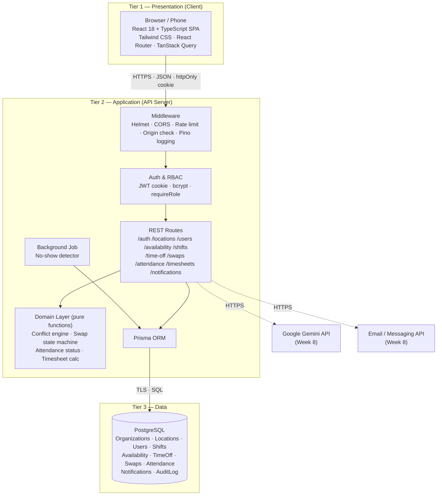
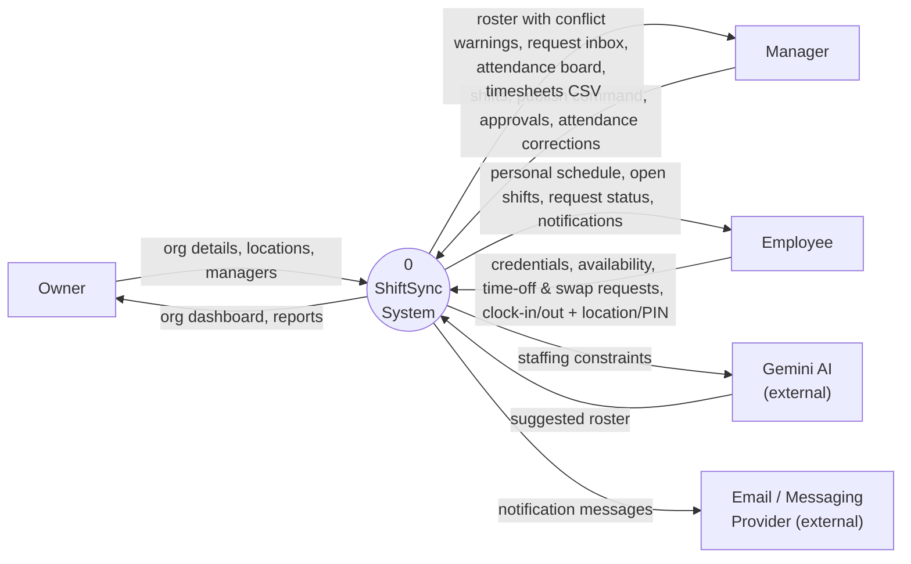
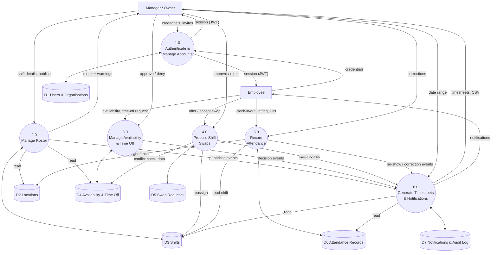
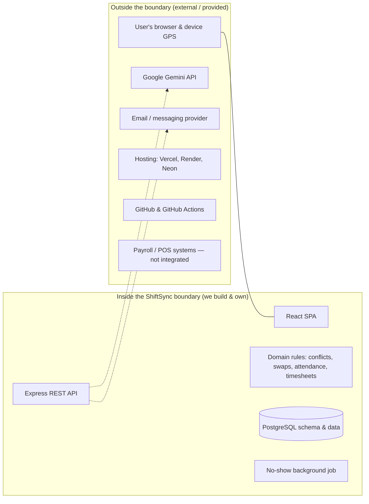
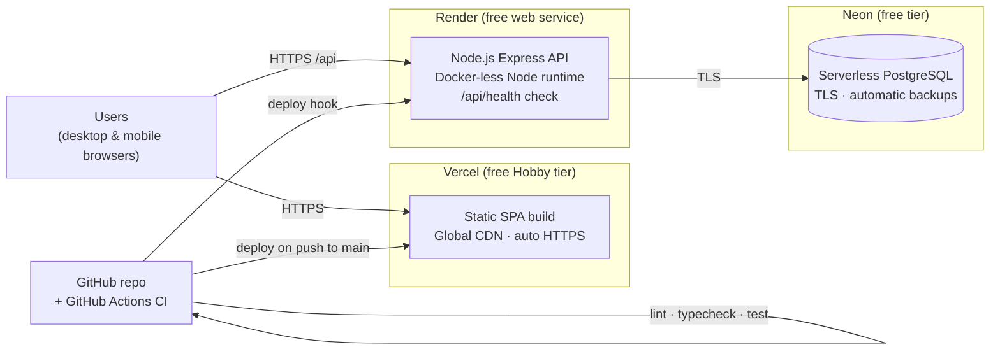

# ShiftSync — Week 3 Progress Report

**High-Level Architecture & Cloud Topology**

| Field | Detail |
|---|---|
| Project ID | PTUT-PRJ-039 |
| Project Title | ShiftSync – Automated Employee Shift Scheduling & Attendance App |
| Track | 4. Local Commerce, SMB & Retail Operations |
| Student | Saniya |
| Roll Number | 24-ST-045 |
| Email | 24-st-045@students.ptut.edu.pk |
| Supervisor | Dr. Zaigham Mushtaq |
| Reporting Week | Week 3 of 12 |

---

## Week 3 Summary of Work Completed

- Designed the 3-tier architecture (Client → API Server → Database) and documented each tier's responsibilities.
- Produced the Data Flow Diagrams at Level 0 (context) and Level 1 (major processes and data stores).
- Defined the system boundary: what ShiftSync owns versus what external services provide.
- Selected and justified a zero-cost cloud stack (Vercel, Render, Neon PostgreSQL, GitHub Actions).
- Documented the request lifecycle, security layers and deployment topology.

---

## 1. Architecture Style

ShiftSync uses a **3-tier, client–server architecture** with a single-page application (SPA) front end, a stateless REST API, and a relational database.

| Decision | Choice | Reason |
|---|---|---|
| Architecture | 3-tier monolith API (modular) | Small team and scope; one deployable API is simpler to build, test and host for free than microservices. |
| API style | REST + JSON | Simple CRUD-heavy domain; easy to test with Supertest and document. |
| Database | Relational (PostgreSQL) | Strong relations (organisation → location → shift → attendance), transactions for swaps/publishing, constraints against double-booking. |
| State | Stateless API (JWT in cookie) | Allows horizontal scaling and free-tier restarts without losing sessions. |
| Multi-tenancy | Shared database, `organizationId` on every row | Lowest cost; isolation enforced in the API layer and by composite foreign keys. |

---

## 2. 3-Tier Architecture Diagram



### 2.1 Tier Responsibilities

| Tier | Technology | Responsibilities |
|---|---|---|
| Presentation | React 18, TypeScript, Vite, Tailwind CSS | Render role-aware screens; client-side routing and route guards; caching and refetching API data; form validation for fast feedback; geolocation capture for clock-in; toast notifications. |
| Application | Node.js 20, Express, TypeScript, Zod, Prisma | Authentication and RBAC; tenant scoping on every query; server-side validation; business rules (conflicts, swaps, attendance, timesheets); transactions; notifications; scheduled no-show detection; structured logging and health check. |
| Data | PostgreSQL | Durable storage; foreign keys and composite keys enforcing tenant consistency; unique constraint preventing duplicate active swaps; indexes for week/location/user queries; managed backups. |

### 2.2 Request Lifecycle (Example: Manager approves a swap)

```mermaid
sequenceDiagram
    participant M as Manager (Browser)
    participant API as Express API
    participant D as Domain Layer
    participant DB as PostgreSQL

    M->>API: POST /api/swaps/:id/approve (cookie)
    API->>API: Helmet, CORS, origin check
    API->>API: Verify JWT, load user, requireRole(MANAGER)
    API->>DB: Load swap + shift scoped by organizationId
    API->>D: canTransition(ACCEPTED → APPROVED)?
    API->>DB: Load acceptor's shifts, availability, time off
    API->>D: detectConflicts(newAssignment)
    alt hard conflict and no override
        API-->>M: 409 SHIFT_OVERLAP + warnings
    else ok
        API->>DB: BEGIN; update shift.userId; swap.status=APPROVED; insert notifications; COMMIT
        API-->>M: 200 updated swap
    end
```

---

## 3. Data Flow Diagrams

### 3.1 DFD Level 0 — Context Diagram



### 3.2 DFD Level 1 — Major Processes



### 3.3 Process Descriptions

| Process | Inputs | Outputs | Data Stores |
|---|---|---|---|
| 1.0 Authenticate & Manage Accounts | Sign-up/login data, invitations | Session cookie, new accounts | D1 |
| 2.0 Manage Roster | Shift details, week, publish command | Draft/published shifts, conflict warnings, hours & cost | D2, D3, D4 |
| 3.0 Manage Availability & Time Off | Availability windows, time-off requests, decisions | Updated availability, request status | D4 |
| 4.0 Process Shift Swaps | Offers, acceptances, approvals | Reassigned shift, swap status | D3, D4, D5 |
| 5.0 Record Attendance | Clock events, location, PIN, corrections | Attendance status (on-time/late/no-show/early leave) | D2, D3, D6, D7 |
| 6.0 Generate Timesheets & Notifications | Date range, events from 2.0–5.0 | Timesheets, CSV, notifications | D3, D6, D7 |

---

## 4. System Boundaries



| In Scope (inside boundary) | Out of Scope (outside boundary) |
|---|---|
| Accounts, organisations, locations, roles | Payroll calculation and salary payment |
| Roster building, conflict detection, publishing | POS / inventory integration |
| Availability, time off, swaps, approvals | Native iOS/Android apps (web is responsive) |
| Attendance capture and status rules | Biometric or hardware time clocks |
| Timesheets, CSV export, in-app notifications | Legal labour-law compliance checks per country |
| AI roster suggestions via Gemini (calls out to external API) | Hosting the AI model itself |

**Trust boundaries:** (1) browser ↔ API — all input untrusted, validated with Zod, authenticated by cookie, origin-checked; (2) API ↔ database — private connection string, TLS, least-privilege role; (3) API ↔ external APIs — keys stored only as server environment variables, never sent to the client.

---

## 5. Cloud Infrastructure & Deployment Topology



### 5.1 Stack Justification

| Component | Choice | Alternatives Considered | Justification |
|---|---|---|---|
| Frontend hosting | **Vercel** | Netlify, GitHub Pages | Free tier, global CDN, automatic HTTPS, first-class Vite support, preview deploys per pull request. |
| API hosting | **Render** | Railway, Fly.io, Heroku | Permanent free web service for Node.js, automatic HTTPS, health checks, env-var secrets; Railway/Heroku no longer free. |
| Database | **Neon PostgreSQL** | Supabase, MongoDB Atlas, PlanetScale | Free serverless Postgres with branching and backups; relational model and transactions fit the domain; Supabase is the backup option. |
| ORM | **Prisma** | TypeORM, raw SQL | Type-safe queries shared with TypeScript, versioned migrations, easy seeding. |
| CI/CD | **GitHub Actions** | GitLab CI, CircleCI | Free for public repos and generous for private; native GitHub integration. |
| Auth | **Self-hosted JWT + bcrypt** | Firebase Auth, Auth0 | Course requires implementing secure auth; avoids vendor lock-in and cost. |
| AI (Week 8) | **Google Gemini API** | OpenAI | Free tier available; required by project plan. |

### 5.2 Free-Tier Constraints and Mitigations

| Constraint | Impact | Mitigation |
|---|---|---|
| Render free service sleeps after ~15 min idle | First request after idle takes ~30–50 s | Uptime ping on `/api/health` during demos; loading state in UI. |
| Neon free storage limit (0.5 GB) | Limits data volume | Ample for pilot (~100 orgs); indexes kept lean. |
| Cross-site cookies between Vercel and Render domains | Browsers may block third-party cookies | Proxy `/api` through Vercel rewrites so the cookie is first-party. |

---

## 6. Security Architecture (Summary)

| Layer | Controls |
|---|---|
| Transport | HTTPS everywhere; HSTS via Helmet. |
| Authentication | bcrypt (cost 12); JWT in httpOnly, Secure, SameSite cookie; 7-day expiry. |
| Authorisation | Role middleware (Owner/Manager/Employee); every query filtered by `organizationId` from the token. |
| Input | Zod schemas on every body/query/param; JSON body size limit 100 KB. |
| Abuse | Rate limiting on auth routes; origin check on state-changing requests. |
| Data | Composite foreign keys tie child rows to the same organisation; audit log for attendance corrections. |
| Secrets | Environment variables only; `.env` git-ignored. |

---

## 7. Progress Note

Alongside the design work, the foundation described in this architecture is already implemented and running locally: the React client, Express API with authentication and tenant isolation, PostgreSQL schema with migrations, and the roster conflict engine, with an automated test suite passing.

## Plan for Week 4

- Construct the database Entity-Relationship Diagram with index definitions.
- Specify the complete REST API endpoint contracts.
- Design UI wireframes for the primary application screens.

---

*Submitted by Saniya (24-ST-045) to Dr. Zaigham Mushtaq — Week 3, PTUT-PRJ-039.*
