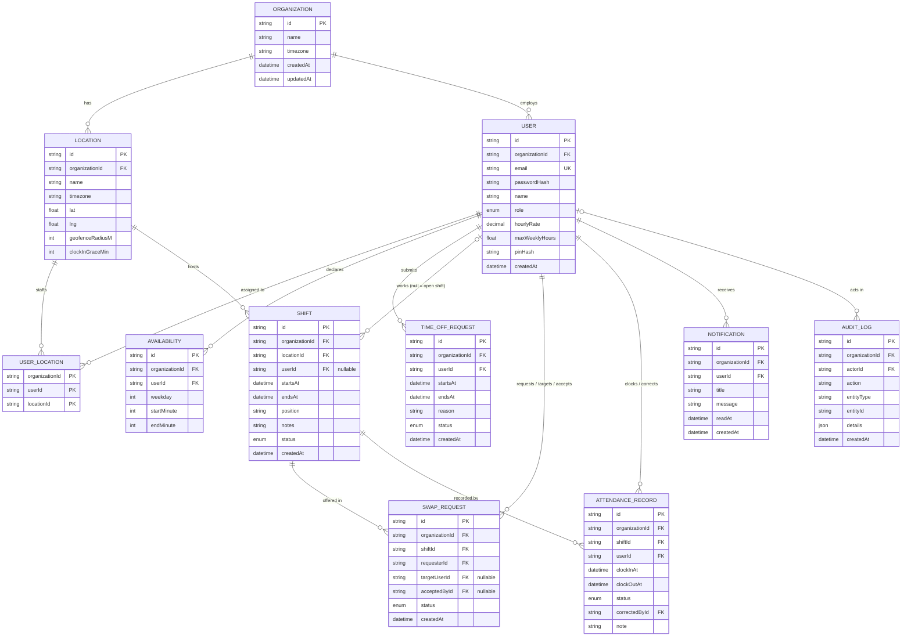

# ShiftSync — Week 4 Progress Report

**Database Modeling, API Contracts & UI Wireframes**

| Field | Detail |
|---|---|
| Project ID | PTUT-PRJ-039 |
| Project Title | ShiftSync – Automated Employee Shift Scheduling & Attendance App |
| Track | 4. Local Commerce, SMB & Retail Operations |
| Student | Saniya |
| Roll Number | 24-ST-045 |
| Email | 24-st-045@students.ptut.edu.pk |
| Supervisor | Dr. Zaigham Mushtaq |
| Reporting Week | Week 4 of 12 |

---

## Week 4 Summary of Work Completed

- Designed the database Entity-Relationship Diagram: **11 entities**, **5 enumerations**, tenant-safe composite foreign keys.
- Defined **17 indexes and unique constraints**, including a PostgreSQL partial unique index that prevents duplicate active swaps.
- Specified the complete REST API contract: **42 endpoints** across 11 resource groups, with request bodies, responses, roles and error codes.
- Designed wireframes for **6 primary screens** (Login, Manager Dashboard, Roster Builder, Requests Inbox, Employee Dashboard & Clock, Attendance Board) plus Timesheets.
- The schema has been implemented as Prisma migrations and the endpoints are implemented and covered by automated tests.

---

## 1. Entity-Relationship Diagram



### 1.1 Enumerations

| Enum | Values |
|---|---|
| Role | OWNER, MANAGER, EMPLOYEE |
| ShiftStatus | DRAFT, PUBLISHED |
| RequestStatus (time off) | PENDING, APPROVED, REJECTED, CANCELLED |
| SwapStatus | PENDING, ACCEPTED, APPROVED, REJECTED, CANCELLED |
| AttendanceStatus | ON_TIME, LATE, NO_SHOW, EARLY_LEAVE |

### 1.2 Key Design Decisions

| Decision | Rationale |
|---|---|
| `organizationId` on every table | Enables shared-database multi-tenancy; every query is filtered by the tenant taken from the session token. |
| Composite foreign keys `(organizationId, id)` | The database itself guarantees that a shift's user, location and swap participants belong to the same organisation — a cross-tenant link cannot be stored even if application code has a bug. |
| Times stored as UTC `timestamptz`; time zone on Location | Correct handling of overnight shifts and daylight saving; displayed in the store's local time. |
| `Shift.userId` nullable | Represents open shifts that any eligible coworker can pick up. |
| Availability as minutes from midnight | Simple integer comparison for conflict checks (e.g. 540 = 09:00). |
| `hourlyRate` as `DECIMAL(10,2)` | Avoids floating-point rounding in cost calculations. |
| Passwords and PINs stored only as bcrypt hashes | Plaintext secrets never persisted. |
| Cascade on organisation delete; Restrict on users referenced by shifts/attendance | Removing a tenant cleans up fully, but historical attendance can't be orphaned by deleting an employee. |

### 1.3 Index Definitions

| # | Table | Index / Constraint | Type | Purpose |
|---|---|---|---|---|
| 1 | User | `email` | UNIQUE | Login lookup; one account per email. |
| 2 | Location | `(organizationId, id)` | UNIQUE | Target of tenant-safe composite FKs. |
| 3 | User | `(organizationId, id)` | UNIQUE | Target of tenant-safe composite FKs. |
| 4 | Shift | `(organizationId, id)` | UNIQUE | Target of tenant-safe composite FKs. |
| 5 | TimeOffRequest | `(organizationId, id)` | UNIQUE | Tenant-scoped lookups. |
| 6 | All tenant tables | `(organizationId)` | B-tree | Fast tenant filtering. |
| 7 | Shift | `(organizationId, locationId, startsAt)` | B-tree | Roster week view per location. |
| 8 | Shift | `(organizationId, userId, startsAt)` | B-tree | Employee schedule, overlap and rest checks. |
| 9 | Availability | `(organizationId, userId, weekday, startMinute)` | UNIQUE | No duplicate windows. |
| 10 | TimeOffRequest | `(organizationId, userId, startsAt)` | B-tree | Time-off conflict lookup. |
| 11 | SwapRequest | `(organizationId, status)` | B-tree | Manager inbox by status. |
| 12 | SwapRequest | `(organizationId, shiftId) WHERE status IN ('PENDING','ACCEPTED')` | **Partial UNIQUE** | At most one active swap per shift (race-safe). |
| 13 | AttendanceRecord | `(organizationId, shiftId, userId)` | UNIQUE | One attendance record per worker per shift. |
| 14 | AttendanceRecord | `(organizationId, userId)` | B-tree | Timesheets per employee. |
| 15 | Notification | `(organizationId, userId, readAt)` | B-tree | Unread count for the bell icon. |
| 16 | AuditLog | `(organizationId, createdAt)` | B-tree | Chronological audit review. |
| 17 | UserLocation | `(organizationId, userId, locationId)` | PRIMARY KEY | Many-to-many staff ↔ location. |

---

## 2. REST API Endpoint Contracts

**Conventions**
- Base path `/api`; JSON request/response; UTF-8.
- Authentication: `shiftsync` httpOnly cookie containing a JWT (7-day expiry). All endpoints except health, sign-up and login require it.
- Timestamps are ISO-8601 instants with offset; weeks are identified by their Monday date (`YYYY-MM-DD`).
- Errors use one shape: `{ "error": { "code": "SHIFT_OVERLAP", "message": "…", "details": { … } } }`.

**Standard error codes**

| HTTP | Code | When |
|---|---|---|
| 400 | VALIDATION_ERROR / INVALID_JSON | Body/query failed Zod validation (`details` lists fields) or malformed JSON. |
| 401 | UNAUTHENTICATED / INVALID_CREDENTIALS | Missing/expired session or wrong login. |
| 403 | FORBIDDEN / ORIGIN_REJECTED / INVALID_PIN / OUTSIDE_GEOFENCE | Role not allowed, untrusted origin, wrong clock-in PIN, or clock-in outside the store radius. |
| 404 | NOT_FOUND | Resource missing **or belongs to another organisation** (no information leak). |
| 409 | SHIFT_OVERLAP / INVALID_TRANSITION / ACTIVE_SWAP / SWAP_CONFLICT / ALREADY_CLOCKED_IN / ATTENDANCE_EXISTS / CONCURRENT_UPDATE | Hard scheduling conflict, invalid swap state change, duplicate active swap, duplicate clock-in, or concurrent edit. |
| 429 | RATE_LIMITED | More than 60 auth requests per 15 min per IP. |
| 500 / 503 | INTERNAL_ERROR / DATABASE_UNAVAILABLE | Unexpected server error (details hidden) or database unreachable. |

### 2.1 Health & Authentication

| Method | Path | Role | Request | Success Response |
|---|---|---|---|---|
| GET | /health | Public | — | 200 `{ status: "ok", database: "connected" }` |
| POST | /auth/signup | Public | `{ organizationName, name, email, password }` | 201 `{ user }` + session cookie |
| POST | /auth/login | Public | `{ email, password }` | 200 `{ user }` + session cookie |
| POST | /auth/logout | Any | `{}` | 204, cookie cleared |
| GET | /auth/me | Any | — | 200 `{ user: { id, name, email, role, organization: { name, timezone } } }` |

### 2.2 Locations & Team

| Method | Path | Role | Request | Success Response |
|---|---|---|---|---|
| GET | /locations | Any | — | `{ locations }` |
| GET | /locations/:id | Any | — | `{ location }` |
| POST | /locations | Manager/Owner | `{ name, timezone, lat?, lng?, geofenceRadiusM?, clockInGraceMin? }` | 201 `{ location }` |
| PUT | /locations/:id | Manager/Owner | same as POST | `{ location }` |
| DELETE | /locations/:id | Manager/Owner | — | 204 |
| GET | /users | Manager/Owner | — | `{ users }` with location ids |
| POST | /users | Manager/Owner | `{ name, email, hourlyRate, maxWeeklyHours, locationIds[] }` | 201 `{ user, tempPassword }` (shown once) |
| PUT | /users/:id | Manager/Owner | `{ name, hourlyRate, maxWeeklyHours, locationIds[], role? }` | `{ user }` (only Owner changes roles) |
| GET | /availability | Any (own) | — | `{ availability: [{ weekday, startMinute, endMinute }] }` |
| PUT | /availability | Any (own) | `{ availability: [...] }` (replaces all) | `{ availability }` |

### 2.3 Shifts (Roster)

| Method | Path | Role | Request | Success Response |
|---|---|---|---|---|
| GET | /shifts?week=&locationId= | Any | query | `{ timezone, shifts: [{ …, location, warnings }] }` — employees see only own published shifts |
| POST | /shifts | Manager/Owner | `{ locationId, userId \| null, startsAt, endsAt, position?, notes?, force? }` | 201 `{ shift, warnings }`; 409 SHIFT_OVERLAP unless `force: true` |
| PUT | /shifts/:id | Manager/Owner | same as POST | `{ shift, warnings }` |
| DELETE | /shifts/:id | Manager/Owner | — | 204 |
| POST | /shifts/copy-previous-week | Manager/Owner | `{ week, locationId, force? }` | `{ shifts, warnings }` |
| POST | /shifts/publish | Manager/Owner | `{ week, locationId, force? }` | `{ published, warnings }` — idempotent |

Warning object: `{ type: "OVERLAP" | "OUTSIDE_AVAILABILITY" | "TIME_OFF" | "WEEKLY_HOURS" | "REST", message, shiftId? }`.

### 2.4 Time Off

| Method | Path | Role | Request | Success Response |
|---|---|---|---|---|
| GET | /time-off | Any | — | `{ requests }` (employee: own; manager: organisation) |
| POST | /time-off | Any (own) | `{ startsAt, endsAt, reason }` | 201 `{ request }` |
| POST | /time-off/:id/cancel | Requester | `{}` | `{ request }` |
| POST | /time-off/:id/decision | Manager/Owner | `{ status: "APPROVED" \| "REJECTED" }` | `{ request }` + notification |

### 2.5 Shift Swaps

| Method | Path | Role | Request | Success Response |
|---|---|---|---|---|
| GET | /swaps | Any | — | `{ swaps }` with shift, location and participant names |
| GET | /swaps/coworkers?shiftId= | Shift owner | query | `{ users: [{ id, name }] }` eligible coworkers |
| POST | /swaps | Shift owner | `{ shiftId, targetUserId? }` (omit = open offer) | 201 `{ swap }`; 409 if an active swap exists |
| POST | /swaps/:id/accept | Eligible coworker | `{}` | `{ swap, warnings }` |
| POST | /swaps/:id/cancel | Requester | `{}` | `{ swap }` |
| POST | /swaps/:id/approve | Manager/Owner | `{ force?: false }` | `{ swap, warnings }` — shift reassigned atomically; 409 on overlap |
| POST | /swaps/:id/reject | Manager/Owner | `{}` | `{ swap }` |

Swap state machine: `PENDING → ACCEPTED → APPROVED`; `PENDING/ACCEPTED → CANCELLED` (requester); `ACCEPTED → REJECTED` (manager).

### 2.6 Attendance

| Method | Path | Role | Request | Success Response |
|---|---|---|---|---|
| GET | /attendance/current | Employee | — | `{ shift, record }` (nullable) — drives the Clock button |
| POST | /attendance/clock-in | Employee | `{ shiftId, pin?, lat?, lng? }` | `{ record }` with status ON_TIME / LATE |
| POST | /attendance/clock-out | Employee | `{ shiftId, pin?, lat?, lng? }` | `{ record }` (EARLY_LEAVE if before end) |
| GET | /attendance | Manager/Owner | — | `{ timezone, shifts }` today's shifts with live status |
| PUT | /attendance/:id | Manager/Owner | `{ clockInAt \| null, clockOutAt \| null, note }` | `{ updated: true }` + audit log entry |

### 2.7 Timesheets & Notifications

| Method | Path | Role | Request | Success Response |
|---|---|---|---|---|
| GET | /timesheets?from=&to=&locationId= | Manager/Owner | query | `{ timezone, rows: [{ user, scheduledHours, actualHours, overtimeHours, lateCount, estimatedCost }] }` |
| GET | /timesheets.csv?from=&to=&locationId= | Manager/Owner | query | `text/csv` attachment (formula-injection safe) |
| GET | /notifications | Any (own) | — | `{ notifications, unreadCount }` |
| POST | /notifications/:id/read | Any (own) | `{}` | 204 |
| POST | /notifications/read-all | Any (own) | `{}` | 204 |

**Total: 42 endpoints** (health 1, auth 4, locations 5, users 3, availability 2, shifts 6, time off 4, swaps 7, attendance 5, timesheets 2, notifications 3 — counting PUT/DELETE on the same path separately).

---

## 3. UI Wireframes

Design principles: mobile-first (usable at 360 px), sidebar navigation on desktop collapsing to a top menu on phones, colour-coded status chips, toast feedback for every action, and role-aware navigation (employees never see manager screens).

### 3.1 Login / Sign-up

```
+--------------------------------------------------+
|                  [#] ShiftSync.                  |
|  +--------------------------------------------+  |
|  |  GOOD TO SEE YOU                           |  |
|  |  Welcome back.                             |  |
|  |                                            |  |
|  |  Email address                             |  |
|  |  [______________________________]          |  |
|  |  Password                                  |  |
|  |  [______________________________]          |  |
|  |                                            |  |
|  |  [          Sign in  ->           ]        |  |
|  |  New to ShiftSync? Get started             |  |
|  +--------------------------------------------+  |
+--------------------------------------------------+
Sign-up adds: Organisation name, Your name. Errors shown as toast.
```

### 3.2 Manager Dashboard

```
+-----------+----------------------------------------------------+
| ShiftSync |                                   [Bell 3]         |
| Corner    |  Hello, Maya.                      [Open roster ->]|
| Mart      |  Here's how your week is shaping up.               |
|-----------|                                                    |
| Overview  |  +-----------+ +-----------+ +-----------+         |
| Roster    |  | Shifts    | | Hours     | | Pending   |         |
| Team      |  |   30      | |  210 h    | | requests 2|         |
| Requests  |  +-----------+ +-----------+ +-----------+         |
| Attendance|                                                    |
| Timesheets|  Today on the floor                                |
| Avail.    |  Aisha  10:00-17:00   [IN · LATE]                  |
| Time off  |  Alex   12:00-19:00   [NOT ARRIVED]                |
|-----------|                                                    |
| MC Maya   |                                                    |
+-----------+----------------------------------------------------+
```

### 3.3 Roster Builder (core screen)

```
+-----------+---------------------------------------------------------------+
| (sidebar) | Your weekly roster                           [+ Add shift]    |
|           | [<] Oct 19 - Oct 25, 2026 [>]  [Main Street v]                |
|           |                      [Copy last week]  [Publish week]          |
|           | 30 shifts · 210 h scheduled · 2 drafts                         |
|           +---------------+-------+-------+-------+-------+-------+------+ |
|           | TEAM MEMBER   | MON19 | TUE20 | WED21 | THU22 | FRI23 | SAT  | |
|           +---------------+-------+-------+-------+-------+-------+------+ |
|           | Aisha Khan    |10-17  |10-17  |10-17  |10-17  |10-17  |  +   | |
|           | 35/40h  595   |Floor  |Cust.  |Floor  |Cust.  |Floor  |      | |
|           | [=======  ]   |       |       |  !    |       |       |      | |
|           +---------------+-------+-------+-------+-------+-------+------+ |
|           | Alex Rivera   |12-19  |12-19  |12-19  |12-19  |12-19  |  +   | |
|           +---------------+-------+-------+-------+-------+-------+------+ |
|           | Open shifts   |       |       |       | 18-22 |       |      | |
|           +---------------+-------+-------+-------+-------+-------+------+ |
|  ! = conflict badge (hover shows: overlap / unavailable / time off /    |
|      over max hours / <10h rest). Draft shifts shown with dashed border.|
+-----------+---------------------------------------------------------------+

Add/Edit shift modal:
+--------------------------------------+
| Make a plan                       [x]|
| Team member  [Aisha Khan        v]   |
| Starts at [10/19 09:00] Ends [17:00] |
| Position  [Floor team          ]     |
| Notes     [                    ]     |
| /!\ Conflicts to review              |
|   - Overlaps another shift.          |
|   - Exceeds weekly hours limit.      |
| [ ] I've reviewed the overlap.       |
|              [Cancel] [Save shift]   |
+--------------------------------------+
```

### 3.4 Requests Inbox (Manager)

```
+-----------+----------------------------------------------------+
| (sidebar) | Requests                                           |
|           | [ Time off ] [ Swaps ]                             |
|           | +------------------------------------------------+ |
|           | | Jordan Ellis                                   | |
|           | | Oct 24 - Oct 25, 2026                          | |
|           | | Family visiting for the weekend · PENDING      | |
|           | | [Approve] [Deny]                               | |
|           | +------------------------------------------------+ |
|           | Swaps tab:                                         |
|           | | Alex -> Priya · Fri 07:00-11:00 · ACCEPTED     | |
|           | | /!\ Priya: exceeds weekly hours                | |
|           | | [Approve] [Approve anyway] [Reject]            | |
+-----------+----------------------------------------------------+
```

### 3.5 Employee Dashboard & Clock (mobile)

```
+------------------------------+
| = ShiftSync.        [Bell 1] |
|------------------------------|
| Hello, Alex.                 |
| +--------------------------+ |
| | Your clock               | |
| | Floor team · 12:00-19:00 | |
| | Main Street              | |
| | PIN [____]               | |
| | [     CLOCK IN      ]    | |
| | Location: within 40 m    | |
| +--------------------------+ |
| This week: 6 shifts · 39 h   |
| Coming up next               |
|  FRI 23  Floor team 12-19    |
|          [Swap]              |
|  SAT 24  Weekend cover 7-11  |
+------------------------------+
```

### 3.6 Attendance Board (Manager)

```
+-----------+----------------------------------------------------+
| (sidebar) | Attendance today        (auto-refresh every 15 s)  |
|           | +--------------+ +--------------+ +--------------+ |
|           | | Jordan Ellis | | Priya Shah   | | Aisha Khan   | |
|           | | 08:00        | | 08:00        | | 10:00        | |
|           | | [NO SHOW]    | | [NO SHOW]    | | [LATE] OUT   | |
|           | |              | |              | | In 10:12     | |
|           | |[Correct rec.]| |[Correct rec.]| | Out 17:00    | |
|           | +--------------+ +--------------+ +--------------+ |
|           | Correct record modal: clock-in, clock-out, note*   |
|           | (* required, saved to audit log)                   |
+-----------+----------------------------------------------------+
```

### 3.7 Timesheets (Manager)

```
+-----------+----------------------------------------------------+
| (sidebar) | Timesheets                        [Download CSV]   |
|           | From [10/19/2026] Through [10/25/2026] [All locs v]|
|           | Employee    Scheduled Actual Overtime Late  Cost   |
|           | Aisha Khan   35.00h   27.20h  0.00h    4   595.00  |
|           | Alex Rivera  39.00h   28.00h  0.00h    0   585.00  |
|           | ...                                                |
+-----------+----------------------------------------------------+
```

### 3.8 Screen ↔ Requirement Map

| Screen | Primary Actors | Requirements (Week 2 SRS) |
|---|---|---|
| Login / Sign-up | All | FR-A1–A4 |
| Manager Dashboard | Manager, Owner | FR-R10, FR-T8 |
| Roster Builder | Manager, Owner | FR-R1–R11 |
| Requests Inbox | Manager, Owner | FR-V4, FR-S4–S6 |
| Employee Dashboard & Clock | Employee | FR-T1–T6, FR-S1 |
| Attendance Board | Manager, Owner | FR-T7–T9 |
| Timesheets | Manager, Owner | FR-N1–N3 |

---

## Plan for Week 5

- Initialise the Git repository with branch protections and push to GitHub.
- Confirm directory scaffolding and database connectivity.
- Implement secure multi-tenant authentication (sign-up, login, bcrypt, JWT session).

---

*Submitted by Saniya (24-ST-045) to Dr. Zaigham Mushtaq — Week 4, PTUT-PRJ-039.*
