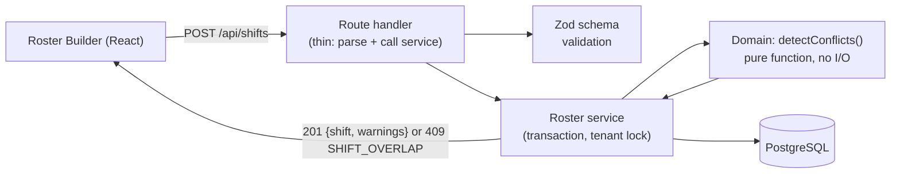

# ShiftSync — Week 6 Progress Report

**Core Business Logic & End-to-End Vertical Slice**

| Field | Detail |
|---|---|
| Project ID | PTUT-PRJ-039 |
| Project Title | ShiftSync – Automated Employee Shift Scheduling & Attendance App |
| Track | 4. Local Commerce, SMB & Retail Operations |
| Student | Saniya |
| Roll Number | 24-ST-045 |
| Email | 24-st-045@students.ptut.edu.pk |
| Supervisor | Dr. Zaigham Mushtaq |
| Reporting Week | Week 6 of 12 |
| Repository | https://github.com/Saniya420/ShiftSync |

---

## Week 6 Summary of Work Completed

- Implemented the **roster conflict engine** — the core domain logic of ShiftSync — as a pure, fully unit-tested function detecting 5 conflict types.
- Implemented the supporting domain rules: **swap state machine**, **attendance status** (on-time / late / early-leave / no-show with geofence distance), and **timesheet calculation**.
- Added **server-side validation** with Zod on every request and a **central error handler** that returns one consistent error format.
- Completed the **vertical slice**: the Roster Builder screen in React talks to the REST API, which applies the conflict engine and stores shifts in PostgreSQL inside transactions.
- Verified the slice manually in the browser and with automated integration tests.

---

## 1. Layered Design of the Business Logic



| Layer | Location | Responsibility |
|---|---|---|
| Routes | `server/src/routes/` | HTTP only: parse input, check role, call a service |
| Validation | `server/src/validation.ts` (+ phase files) | Zod schemas for every body, query and parameter |
| Services | `server/src/services/` | Load data for the tenant, run domain rules, write in a transaction |
| Domain | `server/src/domain/` | Pure business rules — no database, no HTTP — so they are easy to unit test |

## 2. Core Engine: Roster Conflict Detection

`detectConflicts(shift, context)` receives a proposed shift and the employee's other shifts, availability, time off, weekly hour limit and the store's time zone, and returns a list of warnings.

| # | Conflict | Rule | Severity |
|---|---|---|---|
| 1 | `OVERLAP` | The employee already has a shift that overlaps this time | **Hard** — save blocked (409) unless a manager explicitly overrides |
| 2 | `REST` | Less than **10 hours** between the end of one shift and the start of the next | Warning |
| 3 | `OUTSIDE_AVAILABILITY` | Any part of the shift falls outside the employee's recurring weekly availability (checked per day, so overnight shifts are handled) | Warning |
| 4 | `TIME_OFF` | Shift overlaps **approved** time off | Warning |
| 5 | `WEEKLY_HOURS` | Total hours in any Monday–Sunday week would exceed the employee's `maxWeeklyHours` | Warning |

**Design details**
- All times are stored in UTC; availability is interpreted in the **location's time zone** using Luxon, so a 09:00–17:00 availability means 09:00–17:00 Karachi time.
- Overnight shifts (e.g. 22:00–06:00) are split per calendar day for the availability check, and weekly hours are counted by the part of the shift that falls inside each week.
- Open shifts (no employee assigned) produce no conflicts.
- The same function is reused by: creating/editing shifts, copying last week, publishing, approving swaps, and validating AI-suggested rosters — one source of truth for the rules.

**Unit tests:** 19 test cases covering each conflict type, boundaries (exactly 10 h rest, exactly the weekly limit), overnight shifts, time-zone handling, multi-window availability and open shifts.

## 3. Supporting Domain Rules

| Module | Function | What it decides | Tests |
|---|---|---|---|
| `swaps.ts` | `transitionSwap(state, action, actor)` | Legal moves: PENDING → ACCEPTED → APPROVED; PENDING/ACCEPTED → CANCELLED (requester); PENDING/ACCEPTED → REJECTED (manager). Anything else → `INVALID_TRANSITION` | All 20 state × action combinations + actor permissions |
| `attendance.ts` | `attendanceStatus()`, `canClockIn()`, `haversineMeters()` | ON_TIME vs LATE (after grace minutes), EARLY_LEAVE, NO_SHOW; clock-in window from 15 min before start; distance from the store for geofencing | 4 cases incl. overnight shifts |
| `timesheets.ts` | `calculateTimesheets()`, `timesheetsCsv()` | Scheduled vs actual hours, overtime above weekly limit, late count, estimated cost; CSV that is safe against spreadsheet formula injection | 4 cases |

## 4. Server-Side Validation & Error Handling

**Validation (Zod)** — every request body, query string and URL parameter is parsed before use. Examples:
- Timestamps must be ISO-8601 instants **with an offset**; end must be after start; maximum shift length 24 h.
- `week` must be a valid **Monday** date.
- Unknown fields are rejected (`.strict()`), so clients cannot sneak in `organizationId` or `role`.
- Email lower-cased; passwords 12–72 bytes; JSON body limited to 100 KB.

**Central error handler** — all errors become one JSON shape:

```json
{ "error": { "code": "SHIFT_OVERLAP", "message": "This employee already has a shift at this time.", "details": { "warnings": [ ... ] } } }
```

| Source | HTTP | Code |
|---|---|---|
| Zod validation failure | 400 | `VALIDATION_ERROR` (with field details) |
| Malformed JSON | 400 | `INVALID_JSON` |
| Business rule (AppError) | 401/403/404/409 | e.g. `UNAUTHENTICATED`, `FORBIDDEN`, `NOT_FOUND`, `SHIFT_OVERLAP`, `INVALID_TRANSITION` |
| Database unique violation (P2002) | 409 | `ALREADY_EXISTS` |
| Concurrent roster edit (P2034) | 409 | `CONCURRENT_UPDATE` ("refresh and try again") |
| Anything unexpected | 500 | `INTERNAL_ERROR` — details logged server-side, never leaked to the client |

**Concurrency:** roster writes run inside a database transaction that first takes a PostgreSQL **advisory lock for the organisation** (`pg_advisory_xact_lock`), so two managers saving at the same moment are processed one after the other and cannot double-book an employee.

## 5. Vertical Slice: Roster Builder ↔ API ↔ Database

```mermaid
sequenceDiagram
    participant M as Manager (Roster Builder)
    participant API as /api/shifts
    participant S as Roster service
    participant D as detectConflicts()
    participant DB as PostgreSQL

    M->>API: GET /api/shifts?week=2026-10-19&locationId=…
    API->>DB: shifts for tenant + location + week
    API-->>M: shifts with per-shift warnings → week grid, hours & cost
    M->>API: POST /api/shifts {userId, startsAt, endsAt, position}
    API->>S: validated input
    S->>DB: BEGIN; lock tenant; load employee shifts, availability, time off
    S->>D: check proposed shift
    D-->>S: [OVERLAP, WEEKLY_HOURS]
    S-->>M: 409 SHIFT_OVERLAP + warnings (nothing saved)
    M->>API: POST again with force: true (manager ticks "I've reviewed the overlap")
    S->>DB: INSERT shift (DRAFT); COMMIT
    API-->>M: 201 {shift, warnings}
    M->>API: POST /api/shifts/publish {week, locationId}
    API-->>M: {published: n} and employees are notified
```

**Roster Builder features in the slice**
- Week grid (employees × Monday–Sunday) with previous/next week and location selector.
- Add/edit/delete shift dialog with live conflict list and an explicit override checkbox for overlaps.
- Per-employee weekly hours bar and estimated labour cost; totals for the week.
- "Copy last week" and "Publish week" (idempotent — publishing twice changes nothing).

## 6. Verification

**Manual browser test (demo organisation "Corner Mart")**
1. Signed in as manager → Roster Builder shows the seeded week: 30 shifts, 210 scheduled hours.
2. Added a second Monday shift for Aisha (09:00–17:00) on top of her 10:00–17:00 shift.
3. The dialog showed **"Overlaps another shift"** and **"Exceeds the employee's weekly hours limit"**, and saving was blocked until the override box was ticked.

**Automated tests**

| Suite | Cases | Result |
|---|---|---|
| Conflict engine unit tests | 19 | Pass |
| Swap (21 generated cases), attendance and timesheet domain tests | 29 | Pass |
| API integration tests (auth, shifts CRUD, conflicts, copy, publish, tenant isolation) | 18 | Pass |
| Client tests (roster conflict review, publish override) | included in client suite | Pass |
| **Whole project today** | **150 tests (124 server + 26 client)** | **All pass** |

Lint and strict type-check: 0 errors, 0 warnings.

## 7. Challenges & Resolutions

| Challenge | Resolution |
|---|---|
| Availability is local time but shifts are stored in UTC | Convert with the location's IANA time zone (Luxon) before comparing. |
| Overnight shifts cross two weekdays | Split the shift per local calendar day for the availability check. |
| Weekly-hour limit when a shift crosses Sunday midnight | Count only the part of each shift inside each Monday–Sunday interval. |
| Two managers editing the same roster at once | Per-organisation advisory lock inside each roster transaction serialises writers; a database write conflict returns `409 CONCURRENT_UPDATE` ("refresh and try again"). |
| Demo data contained an employee with two overlapping Friday shifts | Found during manual testing; seed corrected so demo data passes its own rules. |

## Plan for Week 7 (Midterm Gate)

- Execute an end-to-end smoke test of the full user journey.
- Compile the midterm progress report and slide deck.
- Prepare and rehearse the live demonstration for the supervisor.

---

*Submitted by Saniya (24-ST-045) to Dr. Zaigham Mushtaq — Week 6, PTUT-PRJ-039.*
